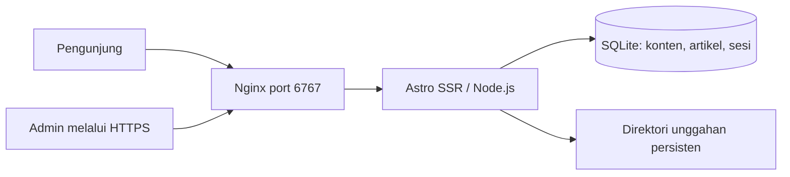
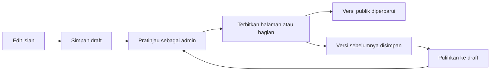
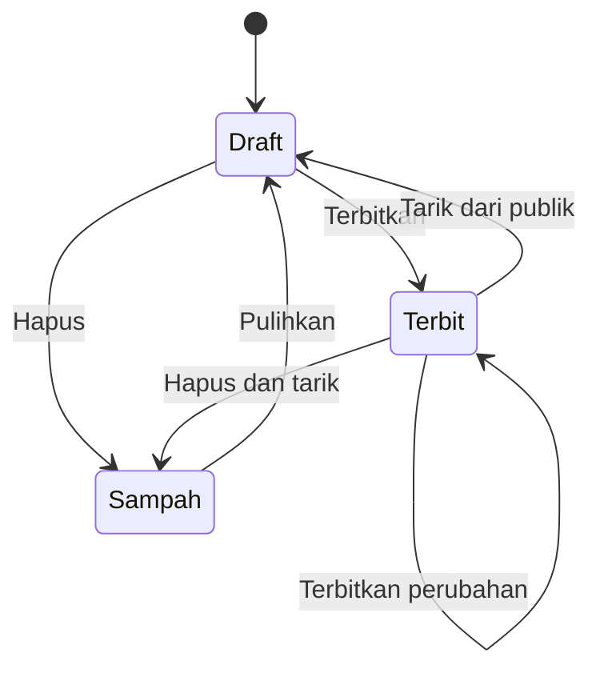

# Rancangan admin dan blog PT Tiga Pilar Dewata

Tanggal: 8 November 2026. Dokumen ini menjelaskan rancangan yang sudah diimplementasikan di repository. Panduan penggunaan dan hosting: [ADMIN_BLOG.md](ADMIN_BLOG.md).

## Tujuan

Pengelola dapat memperbarui konten company profile dan menerbitkan blog tanpa mengubah source code atau menjalankan build setiap kali konten berubah. Website tetap terpisah dari aplikasi, database, dan akun Siwride.

Kebutuhan admin dan blog ini menggantikan batas versi awal dalam `COMPANY_PROFILE_KNOWLEDGE.md` yang sebelumnya belum membutuhkan CMS. Aturan fakta perusahaan dan verifikasi kanal resmi tetap digunakan.

## Arsitektur

Astro dipertahankan agar komponen, bahasa, dan identitas visual yang ada tetap digunakan. Adapter Node menjalankan halaman dinamis dan endpoint admin. SQLite dipilih untuk instalasi awal dalam satu server: tidak membutuhkan layanan database tambahan. Gambar dioptimalkan menjadi WebP menggunakan Sharp.

Data SQLite dan gambar berada di `CMS_DATA_DIR`, terpisah dari `dist/` dan release aplikasi. Konten diterbitkan melalui transaksi database. Build dan restart hanya diperlukan untuk perubahan kode.

Konsekuensinya: halaman publik membutuhkan runtime Node dan penyimpanan yang sehat. Mode hosting Nginx statis lama perlu dimigrasikan. Jika kelak dibutuhkan beberapa instance aplikasi atau banyak penulis bersamaan, lapisan penyimpanan dapat dipindahkan ke PostgreSQL dan penyimpanan objek; SQLite tidak dibagikan melalui network filesystem.

## Struktur admin

| Menu | Kemampuan yang tersedia |
| --- | --- |
| Ringkasan | Jumlah artikel terbit, draft, media, draft konten yang belum terbit, aktivitas terbaru |
| Identitas & Kontak | Nama/teks logo, email, telepon, alamat, WhatsApp, situs Siwride, kanal sosial, gambar hero/about/logo |
| Konten Website | Pilih halaman lalu edit section berurutan pada tab Indonesia/English; daftar layanan dikelola di halaman khusus |
| Artikel Blog | Buat, baca, ubah, simpan draft, preview, terbitkan, tarik, hapus ke sampah, pulihkan |
| Kategori Blog | Tambah, ubah nama ID/EN, hapus jika tidak dipakai |
| Pustaka Media | Unggah, optimalkan, lihat, salin tautan, hapus gambar yang tidak digunakan |
| Akun Saya | Ganti password dan akhiri seluruh sesi |

Admin menggunakan bahasa Indonesia. Satu jenis akses pengelola tersedia pada versi ini; semua akun pengelola memiliki izin yang sama. Pembuatan dan pemulihan akun dilakukan melalui CLI, tanpa pendaftaran publik.

## Pemetaan konten lama

| Sumber awal | Pengelolaan setelah migrasi |
| --- | --- |
| `src/data/company.ts` | Seed identitas, kontak, layanan, dan mitra; perubahan setelah inisialisasi tersimpan di SQLite |
| `src/i18n/messages.ts` | Seed teks EN/ID; editor hanya mengizinkan isi editorial, sedangkan label template dipertahankan |
| `src/templates/home.astro` | Teks, hero, layanan, mitra, dan artikel terbaru dari CMS |
| `src/templates/about.astro` | Teks, gambar, dan CTA dari CMS |
| `src/templates/siwride.astro` | Teks, ilustrasi produk, dan daftar layanan dari CMS |
| `src/templates/partnership.astro` | Teks, daftar jenis mitra, dan langkah pengajuan dari CMS |
| `src/templates/contact.astro` | Teks, email, telepon, alamat, WhatsApp dan tautan produk dari CMS |
| Header, footer, komponen bersama | Identitas, kontak, kanal sosial, dan gambar dari CMS; nama menu, tombol, serta teks sistem mengikuti template |

Struktur halaman dan gaya tetap menggunakan template. Penambahan jenis halaman atau komponen baru memerlukan perubahan kode. Bagian yang belum memiliki fakta perusahaan, seperti sejarah, tim, atau testimoni, tidak ditambahkan otomatis.

## Alur pengelolaan company profile

Penyimpanan tetap memiliki tiga scope: **global**, **ID**, dan **EN**. Global berisi identitas, kontak, serta gambar bersama. Editor Konten Website menampilkan semua section satu halaman pada satu bahasa dalam satu form. Publikasi menerapkan seluruh section halaman aktif; layanan dan kemitraan tetap digunakan bersama oleh beranda dan halaman terkait.

Konfigurasi editor menentukan halaman dan section publik yang dapat diedit langsung. Navigasi, label tombol, metadata template, dan teks sistem tidak menjadi isian. Semua section halaman ditampilkan vertikal; tombol gambar section membuka gambar bersama yang sesuai. Layanan dan mitra menggunakan daftar ringkas yang dapat dibuka per item, dengan daftar layanan hanya tersedia pada halaman khususnya. Satu menu Konten Website menggantikan dua menu bahasa; tab bahasa mempertahankan halaman yang sedang dipilih.

Indonesia menjadi sumber. Tombol **Terjemahkan ke English** memanggil Google Cloud Translation Basic v2 melalui server, lalu menyimpan draft Indonesia dan English halaman aktif dalam satu transaksi. Editor membuka English untuk ditinjau; publikasi tetap terpisah dan manual. Draft English halaman lain, label template, ikon, dan nomor urutan dipertahankan. Pemeriksaan versi kedua bahasa sebelum dan sesudah panggilan layanan mencegah tab lama menimpa perubahan baru. Kegagalan layanan atau transaksi tidak mengubah draft tersimpan. Key opsional `GOOGLE_TRANSLATE_API_KEY` mengaktifkan tombol; tanpa key, konten lama tetap tersedia. Petunjuk konfigurasi ada di ADMIN_BLOG.md.

Logo, hero beranda, dan gambar tentang perusahaan diunggah langsung dari Identitas & Kontak dengan preview draft tersimpan dan preview lokal untuk pengganti. File diunggah saat menyimpan atau menerbitkan, maksimal 5 MB per gambar dan 16 MiB untuk seluruh formulir. Tanpa pengganti, referensi gambar tetap dipertahankan. Unggahan dari permintaan yang gagal dibersihkan; gambar lama tetap tersedia untuk riwayat. Tidak diperlukan migrasi database.

Simpan draft tidak mengubah halaman publik. Preview menuju halaman terkait, membutuhkan sesi admin, dan membaca draft tersimpan. Riwayat menyimpan versi sebelum publikasi; pemulihan mengambil isi halaman aktif ke draft dan tetap membutuhkan tindakan terbitkan. Identitas & Kontak tetap dipulihkan dan diterbitkan bersama. Nomor versi mencegah tab lama menimpa perubahan baru.

## Blog publik

| Halaman | English | Indonesia |
| --- | --- | --- |
| Daftar artikel | `/blog/` | `/id/blog/` |
| Detail artikel | `/blog/{slug}/` | `/id/blog/{slug}/` |

Daftar menampilkan sampul, kategori, tanggal, judul, ringkasan, dan tautan baca. Tersedia pencarian, filter kategori, serta pagination sembilan artikel per halaman. Beranda menampilkan tiga artikel terbit terbaru pada bahasa yang aktif; section tetap tampil dengan keadaan kosong jika belum ada artikel.

Detail artikel menampilkan penulis, sampul beserta alt, isi, metadata SEO/Open Graph, tombol berbagi, dan maksimal tiga artikel terkait. Tidak ada artikel contoh yang diterbitkan otomatis. Status indexing publik tetap `noindex, nofollow` mengikuti proyek sebelumnya.

## Data dan alur artikel

| Kelompok | Isian |
| --- | --- |
| Identitas | ID, bahasa, grup terjemahan, judul, slug |
| Konten | Ringkasan, isi Markdown, sampul, alt gambar |
| Editorial | Penulis, kategori, waktu terbit pertama, waktu pembaruan |
| SEO | Judul SEO dan deskripsi SEO; fallback ke judul/ringkasan |
| Publikasi | Snapshot draft, snapshot terbit, nomor versi, waktu masuk sampah |

Isi artikel menggunakan editor dengan tombol format dan preview. Markdown dirender di server lalu disanitasi; kode HTML berbahaya tidak diteruskan ke publik.

Snapshot draft dan terbit dipisahkan. Mengubah artikel yang sudah terbit tidak langsung mengganti artikel publik. Penghapusan menggunakan sampah; pemulihan menghasilkan draft. Riwayat versi artikel lengkap dan penjadwalan terbit belum termasuk versi ini.

Artikel ID dan EN terhubung melalui grup terjemahan, tetapi memiliki slug serta publikasi masing-masing. Switcher hanya menyediakan versi terjemahan yang sudah terbit. Mengubah slug membuat URL lama mengarah 301 ke URL baru. URL lama tetap dicadangkan bagi artikel yang sama, termasuk saat artikel ditarik.

## Penyimpanan

| Tabel | Fungsi |
| --- | --- |
| `users` | Akun pengelola dan hash password |
| `sessions` | Hash token sesi, CSRF, kedaluwarsa |
| `login_limits` | Pembatas percobaan login per email |
| `content` | Snapshot draft/terbit per scope dan versi |
| `content_history` | Snapshot konten sebelum publikasi |
| `posts` | Artikel per bahasa beserta snapshot draft/terbit |
| `post_routes` | Pemetaan slug aktif maupun lama ke artikel |
| `categories` | Nama kategori Indonesia dan English |
| `media` | Metadata dan nama file hasil optimasi |
| `audit` | Aktivitas pengelolaan |

Relasi pengguna/sesi dan artikel/route menggunakan foreign key. Kategori di snapshot artikel divalidasi aplikasi; kategori yang digunakan draft atau artikel tidak dapat dihapus. Penghapusan media juga memeriksa referensi draft, publik, artikel di sampah, dan riwayat company profile.

## Perlindungan yang diterapkan

Password memakai scrypt dengan salt acak. Token sesi disimpan sebagai hash; cookie menggunakan HttpOnly, SameSite Strict, masa berlaku 12 jam, dan Secure pada origin HTTPS. Form admin memerlukan origin yang cocok serta token CSRF, kecuali form login yang menggunakan pemeriksaan origin. Percobaan login dibatasi delapan per email dalam 15 menit.

Tidak ada akun/password bawaan. Preview tidak di-cache dan tidak tersedia bagi pengunjung anonim. Upload dibatasi 5 MB, diperiksa melalui decoder gambar, dibatasi 40 megapiksel, diubah menjadi WebP, dan disimpan memakai nama acak. File selain gambar yang didukung ditolak. Media memang merupakan aset publik setelah diunggah.

## Tahapan implementasi dan pengembangan berikutnya

| Tahap | Hasil | Status |
| --- | --- | --- |
| 1 | Rendering Node, SQLite, akun, sesi, perlindungan form | Diimplementasikan |
| 2 | Editor company profile, preview, publish, riwayat | Diimplementasikan |
| 3 | CRUD blog, kategori, terjemahan, editor dan preview | Diimplementasikan |
| 4 | Blog publik, pencarian, filter, pagination, artikel terkait | Diimplementasikan |
| 5 | Pustaka media, aktivitas, penggantian password | Diimplementasikan |
| 6 | Tes integrasi, tes browser, dokumentasi, persiapan deploy SSR | Pemeriksaan lokal lulus; hasil dan batas verifikasi lihat panduan |
| 7 | Migrasi hosting Snail 2 ke Node dan HTTPS | Dijalankan saat publikasi; belum diterapkan ke server |

Pengembangan berikutnya dapat mencakup role editor/publisher, penjadwalan, autosave, riwayat versi artikel, pemulihan password melalui email, pencarian skala besar, analitik, dan sitemap/RSS saat indexing publik dibuka. Fitur tersebut tidak dianggap sudah tersedia.

## Acuan teknis

- [Routing Astro](https://docs.astro.build/en/guides/routing/): route detail dinamis pada mode server.
- [Rendering on demand](https://docs.astro.build/en/guides/on-demand-rendering/): rendering runtime menggunakan adapter.
- [Adapter Node](https://docs.astro.build/en/guides/integrations-guide/node/): output standalone dan entrypoint server.
- [Content collections](https://docs.astro.build/en/guides/content-collections/): membedakan data saat build dan runtime; implementasi ini mengakses SQLite melalui service aplikasi.
- [Internationalization](https://docs.astro.build/en/guides/internationalization/): EN tanpa prefix, ID menggunakan `/id/`.
